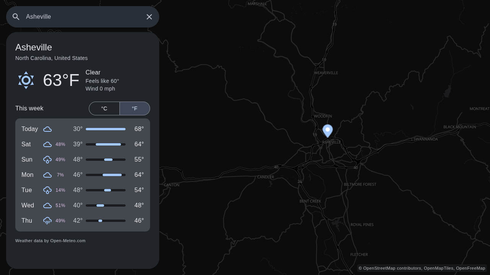
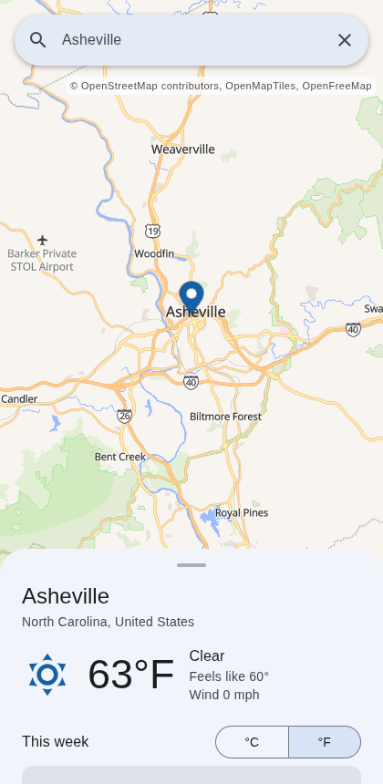

# react-native-weather

A weather app in React Native (Expo). One screen: a map with a Material 3
search bar over it. Search for a place, or press and hold on the map, and the
forecast for the week appears.

**Live demo:** <https://calemccammon.github.io/react-native-weather/>

| Wide window                                                                                                 | Phone                                                                                         |
| ----------------------------------------------------------------------------------------------------------- | --------------------------------------------------------------------------------------------- |
|  |  |

It is one of four builds of the same app, alongside
[flutter-weather](https://github.com/calemccammon/flutter-weather),
[kmp-weather](https://github.com/calemccammon/kmp-weather) and
[maui-weather](https://github.com/calemccammon/maui-weather),
to compare the frameworks.

## What it does

- **Search** with results as you type, after a short pause; an answer to an
  older search never replaces a newer one.
- **Pick a point** by pressing and holding on the map.
- **Forecast**: current conditions, then seven days with the chance of
  precipitation and each day's range drawn against the week's.
- **Adapts to the window**: a draggable bottom sheet on a phone, a side panel
  from 840 px wide. The map keeps the chosen place clear of both.
- **Celsius or Fahrenheit**, chosen on the forecast and remembered between
  launches. Until you choose, it follows the device's region.
- **Light and dark** themes from one seed colour, following the system. The
  map changes style with them.
- **Accessible**: each forecast block is read as one sentence by a screen
  reader, and the forecast's columns grow with the device's text size.
- **Says what went wrong**: a timeout, no connection and a refused request
  each have their own message and a way to try again.

## Architecture

Clean Architecture in three layers. Dependencies point inward only: `data`
and `ui` import `domain`, and `domain` imports neither, nor any library.
`npm run lint` fails on an import that breaks this (the rules are in
`eslint.config.js`).

| Path          | What it holds                                                                                                                                                                                                                                                                                              |
| ------------- | ---------------------------------------------------------------------------------------------------------------------------------------------------------------------------------------------------------------------------------------------------------------------------------------------------------- |
| `src/domain`  | The app's own types (`Place`, `Forecast`, `WeatherCondition`, `Units`), the repository interfaces (`WeatherRepository` with its failure kinds, `SettingsRepository`), and the use cases (`SearchPlaces`, `GetForecast`, `GetUnits`, `SetUnits`) that hold the rules. Plain TypeScript: no React, no Expo.  |
| `src/data`    | Open-Meteo: the wire-shaped models (`*Dto.ts`), their translation into domain types, and the repository implementation. Settings are kept with AsyncStorage.                                                                                                                                               |
| `src/l10n`    | Every string the user sees, in `en.json`, read through `i18next`. The keys are typed, so a misspelt one fails `npm run typecheck`.                                                                                                                                                                         |
| `src/ui`      | `core` has the theme, its design tokens and the mapping from domain values to wording and icons. `home` has `models` (what the screen shows, already worded and rounded), `viewModels` (call use cases and produce those models) and `components` (draw them, and import nothing from the domain or data). |
| `src/di`      | `buildContainer` wires use cases and view models over whichever repositories it is given; `createContainer` gives it the real ones. Nothing else imports from here but `App.tsx`, which hands the view models to the screen.                                                                               |
| `src/testing` | Fakes shared by the tests, which sit beside the code they test as `*.test.ts`.                                                                                                                                                                                                                             |

Each layer has its own model of the same thing, and a translation between
them:

|              | Data                           | Domain       | UI                                                                  |
| ------------ | ------------------------------ | ------------ | ------------------------------------------------------------------- |
| Type         | `ForecastDto`                  | `Forecast`   | `ForecastUiModel`                                                   |
| A day's high | `temperature_2m_max[1] = 64.3` | `high: 64.3` | `high: "64°"`, `barEnd: 0.75`                                       |
| Conditions   | `weather_code: 3`              | `'overcast'` | an icon name and `"Overcast"`                                       |
| A failure    | HTTP 400, a timeout            | `'rejected'` | `t('failure.rejected')`: "The weather service refused the request." |

State is held by two view models, `HomeViewModel` and `SearchViewModel`. Each
is a plain class that owns a [zustand](https://zustand.docs.pmnd.rs/) store
of one state type, so it is tested without rendering anything; components
subscribe to the store.

The map is the one component with a version per platform:
`WeatherMap.tsx` uses MapLibre Native on Android and iOS, and
`WeatherMap.web.tsx` uses MapLibre GL JS, because the React Native package
does not render in a browser. Both take the same props.

## Running

Expo SDK 58, React Native 0.88, Node 24. Targets: Android, iOS and web.

MapLibre contains native code, so the app runs as a development build, not in
Expo Go. The `android/` and `ios/` folders are generated and not committed.

```sh
npm install
npm run android        # builds and installs the dev build, then starts Metro
npm run web            # the app in a browser, through react-native-web
npm run build:web      # static site in dist/
npm start              # later runs: Metro only, reusing the installed build
```

Start the emulator first with `emulator -avd Pixel_API_36`, or from Android
Studio's Device Manager. iOS builds need a Mac and have not been run.

Add packages with `npx expo install <name>` so versions match the Expo SDK.

## Checks

```sh
npm run format:check   # Prettier; `npm run format` fixes
npm run lint           # ESLint; any warning fails
npm run typecheck
npm test
```

`.github/workflows/ci.yml` runs these on pushes to `main` and on pull
requests, then builds the web app. On `main`, and on demand from the Actions
tab, it also builds an Android debug APK. Both builds are uploaded as
workflow artifacts.

`.github/workflows/pages.yml` builds the web app and publishes it to
`https://calemccammon.github.io/react-native-weather/`. It runs only when
started by hand from the Actions tab, and needs the repository to be public.
The base path `/react-native-weather` is set in `app.json`
(`experiments.baseUrl`).

## Data and credits

- Place search and forecasts: [Open-Meteo](https://open-meteo.com/) (no key;
  free for non-commercial use; CC BY 4.0).
- Map: [OpenFreeMap](https://openfreemap.org/) styles and tiles (no key),
  from [OpenMapTiles](https://openmaptiles.org/) and
  © [OpenStreetMap](https://www.openstreetmap.org/copyright) contributors,
  drawn with [MapLibre](https://maplibre.org/).

## Known limits

- **English only.** The wording is all in `src/l10n/en.json` and weekday
  names follow the app's language, so a second language is one more file;
  none has been written.
- **Places are not saved**: the chosen place is forgotten when the app
  closes. Only the choice of units is kept.
- **The bottom sheet drags by its handle only.** Its content scrolls, and
  does not pull the sheet up as it does in Material's own.
- **Very large text** widens the forecast's columns and drops the range bar
  when there is no room, but the rows do not shrink to fit beyond that.

## Not built

Ideas that were considered and left out, roughly in the order they would be
worth doing:

- **Saved places** shown when the app opens.
- **Forecast for the current location**, which needs the location permission
  on each platform.
- **A second language**, to exercise the localisation set-up.
- **Rain radar** as a layer over the map.
- **A signed release build** from CI, and a published web build once the
  repository is public.
